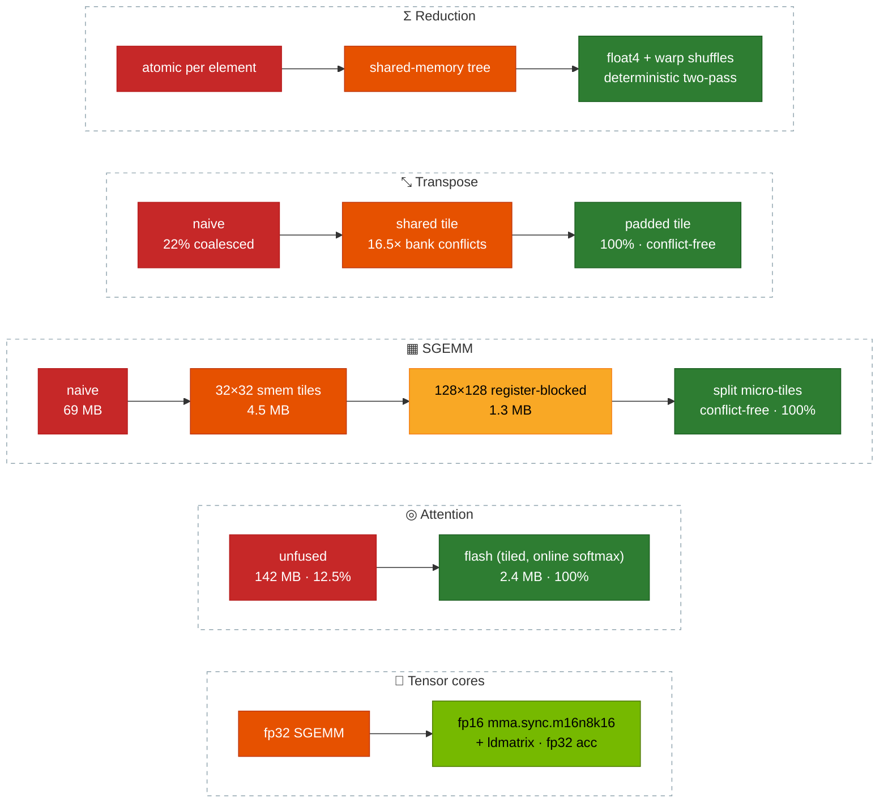
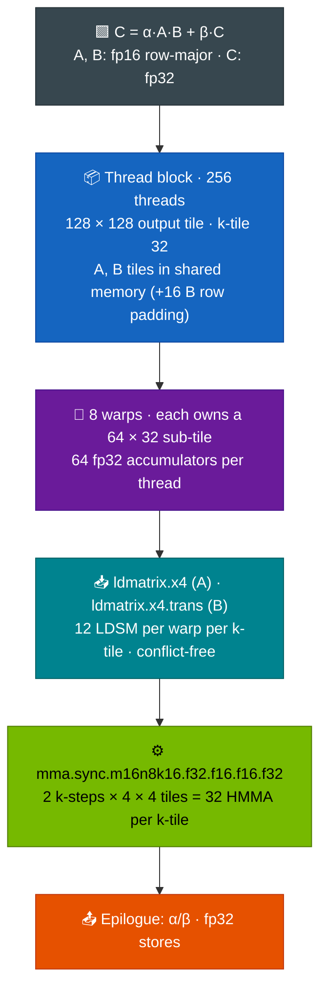
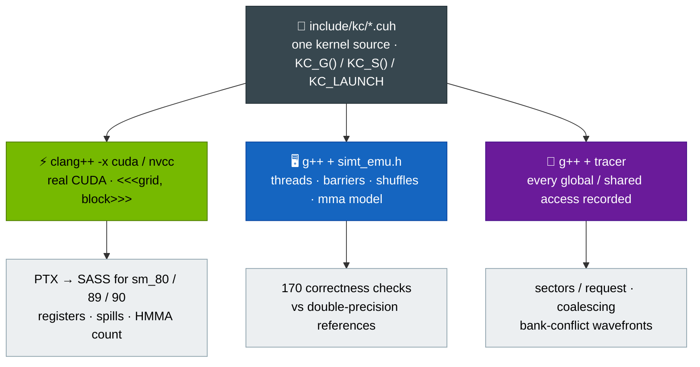
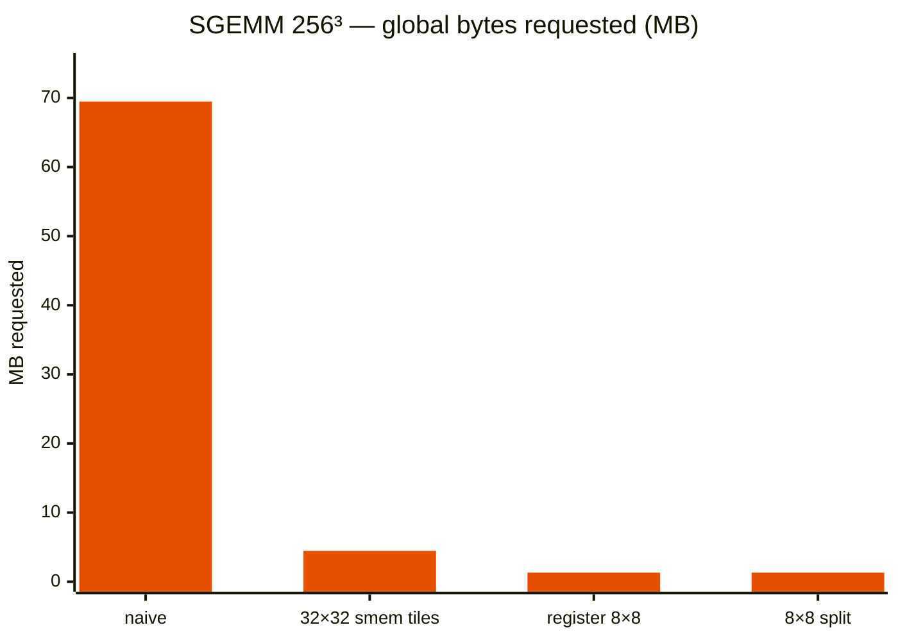
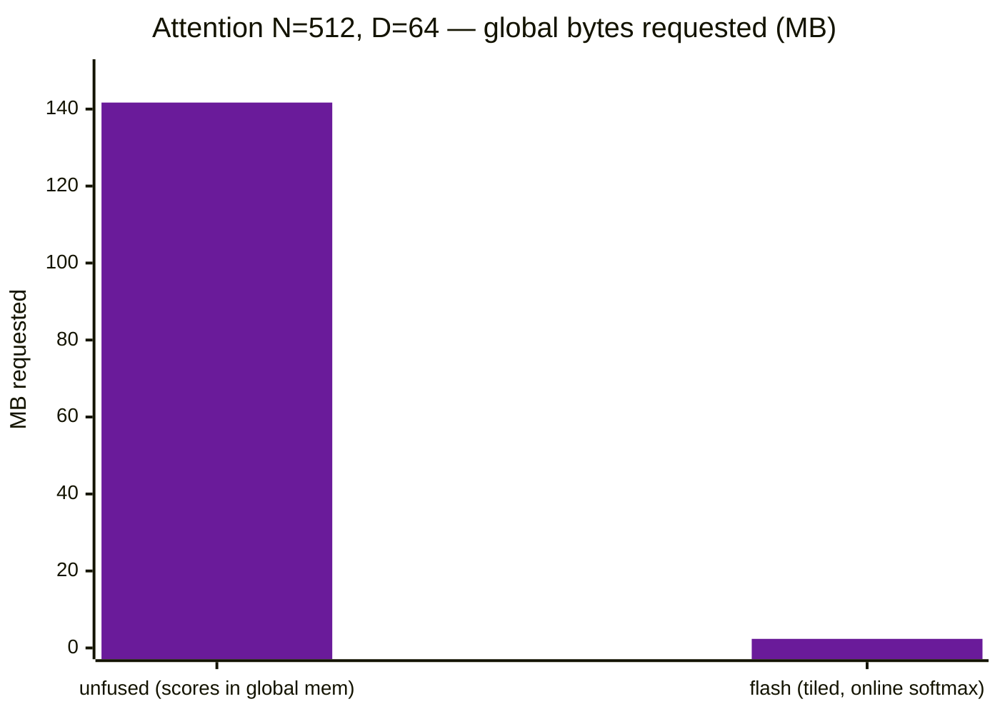
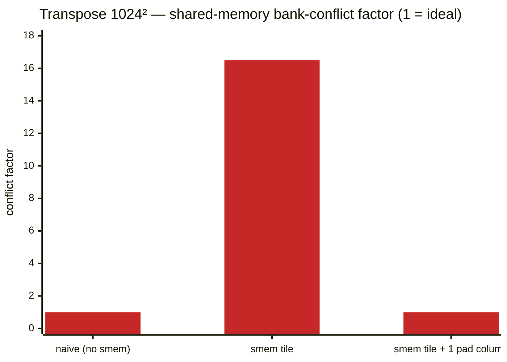
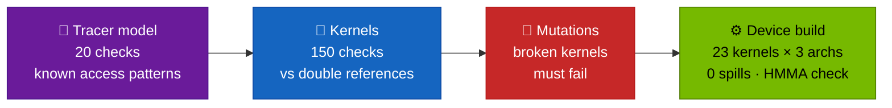
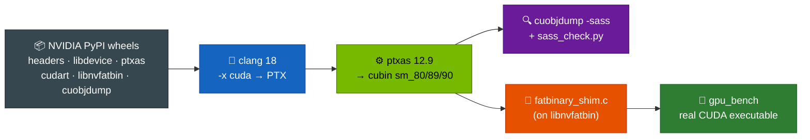

<div align="center">

# ⚡ CUDA-KERNELS

### Hand-written GPU kernels — from naive to tensor cores — with a CPU SIMT emulator that proves they are correct

**Reduction · transpose · SGEMM · online softmax · Welford LayerNorm · flash attention · `mma.sync` tensor-core GEMM · backward passes**

<br/>


</div>

---

## ⚡ TL;DR

This is a **kernel engineering lab**. Every kernel is written as an *optimisation progression*, so each step — coalescing, shared-memory tiling, bank-conflict padding, register blocking, vectorisation, warp shuffles, IO-aware fusion, tensor cores — has a measurable effect.

- 🧮 **A tensor-core GEMM in raw inline PTX.** fp16 in, fp32 accumulate, `ldmatrix.x4` / `ldmatrix.x4.trans` feeding `mma.sync.m16n8k16`. The SASS confirms **32 × `HMMA.16816.F32` + 12 × `LDSM` per warp per k-tile** on A100, RTX 40xx and H100.
- 🖥️ **A CPU SIMT emulator** that runs the *same source* unchanged: real OS threads per block, `std::barrier` for `__syncthreads`, warp shuffles, and a warp-level model of the `mma` / `ldmatrix` fragment layouts. A kernel that loads fragments in the wrong layout gives wrong numbers.
- 🔬 **A memory-access tracer** that computes what Nsight Compute would report — 32-byte sectors per request and shared-memory bank-conflict wavefronts — from a model of the hardware rules.
- 🧪 **170 checks** against double-precision references with derived error bounds, plus **mutation testing**: deliberately broken kernels (missing barrier, wrong fragment mapping, missing `.trans`, …) must fail the suite.
- 🛠️ **A GPU toolchain without a GPU**: clang 18 + NVIDIA `ptxas` and `libnvfatbin` assembled from PyPI wheels, plus a custom `fatbinary` shim, link a real CUDA benchmark binary.

> [!IMPORTANT]
> **No GPU timings are claimed.** This was built on a machine without an NVIDIA GPU. Correctness is verified on the emulator, the code is compiled to real SASS for three architectures, and memory behaviour is *modelled*. The benchmark harness is built and scripted for an RTX 4060 run ([`docs/OWNER_ACTIONS.md`](docs/OWNER_ACTIONS.md)); measured GFLOP/s will be added after that run.

---

## 🗺️ The optimisation progressions



Plus **row kernels** — warp-per-row online softmax and Welford LayerNorm (numerically safe up to `FLT_MAX`, `-inf` masking, no cancellation at mean 10⁴) — and **backward passes** for softmax and LayerNorm (dx, dγ, dβ).

| File | Kernels | Key technique |
|---|---|---|
| `reduce.cuh` | atomic → shared tree → float4 + shuffles, two-pass | grid-stride loops, `__shfl_xor_sync`, deterministic second pass |
| `transpose.cuh` | naive → shared tile → padded tile | coalescing through shared memory, bank-conflict padding |
| `gemm.cuh` | naive → 32×32 tiles → 128×128×8 register-blocked (8×8 per thread), contiguous and *split* | transposed A tile, float4 shared loads, conflict-free split micro-tiles, float4 epilogue |
| `softmax.cuh` | online softmax, Welford LayerNorm (+ naive E[x²]−E[x]² for contrast) | single-pass statistics merged with shuffles |
| `hgemm.cuh` + `mma.cuh` | tensor-core GEMM, fp16 A/B, fp32 C | inline PTX, 16-byte padded rows for conflict-free `ldmatrix`, vector or zero-filled element loads |
| `backward.cuh` | softmax backward, LayerNorm backward | warp per row; deterministic dγ/dβ |
| `attention.cuh` | flash attention (optional causal mask) + unfused baseline | IO-aware tiling, Q/O staged through padded shared memory |

---

## 🧮 Tensor-core GEMM — how the work is split



**Proof that it really uses tensor cores** — `cuobjdump -sass` on the sm_80 cubin ([full excerpt](docs/evidence/2026-10-15/sass_hgemm_excerpt.txt)):

```text
LDSM.16.M88.4  R24, [R2] ;
LDSM.16.MT88.4 R20, [R86] ;          ← ldmatrix .trans for B
LDSM.16.MT88.4 R8,  [R87] ;
HMMA.16816.F32 R76, R24.reuse, R20, R76 ;
HMMA.16816.F32 R72, R24.reuse, R22, R72 ;
HMMA.16816.F32 R68, R24.reuse, R8,  R68 ;
HMMA.16816.F32 R64, R24,       R10, R64 ;
```

`tools/sass_check.py` fails the build if any tensor-core kernel contains no HMMA instruction.

| Arch | HMMA (form) | LDSM | Registers | Shared mem | Blocks / SM | Occupancy |
|---|---|---|---|---|---|---|
| sm_80 (A100) | 32 × `HMMA.16816.F32` | 12 | 123–124 | 18,944 B | 2 | 25 % |
| sm_89 (RTX 40xx, L4) | 32 × `HMMA.16816.F32` | 12 | 122–126 | 18,944 B | 2 | 33 % |
| sm_90 (H100) | 32 × `HMMA.16816.F32` | 12 | 123–126 | 18,944 B | 2 | 25 % |

---

## 🖥️ One source, three builds



### Inside the emulator

| GPU concept | Emulated as |
|---|---|
| Thread block | `blockDim` real OS threads from a persistent pool; blocks run one after another |
| `__syncthreads()` | `std::barrier` across the block — a missing barrier is a **real data race** the tests catch |
| `__shared__` | `static` storage, safe because blocks don't overlap |
| Warp shuffles | per-warp exchange buffer between two warp barriers |
| `ldmatrix` | each lane posts a row address, then picks its two 16-bit elements per matrix from the PTX ISA layout (transposed for `.trans`) |
| `mma.m16n8k16` | each lane posts its A/B fragments; the model rebuilds the 16×16 and 16×8 matrices from the documented layout and returns each lane's 4 fp32 outputs |
| Global memory cost | distinct 32-byte sectors per warp instruction |
| Shared memory cost | phases of 32 / 16 / 8 lanes for 4 / 8 / 16-byte accesses; wavefronts = worst bank's distinct words; broadcasts free |

The tracer itself is pinned by 20 tests against patterns with known answers: strides 1/2/32, misalignment, float4, broadcast, predication, and bank strides 1/2/32/33.

---

## 📊 What the evidence shows

All memory figures come from **modelled traces** (`make analyze`), not hardware counters. They show *why* one variant should be faster, not *how much*.







| Optimisation step | Before → after |
|---|---|
| Transpose: shared tile → padded | bank-conflict factor **16.5 → 1.0**, 100 % coalesced (naive: 22 %) |
| SGEMM: naive → 32×32 tiles → register-blocked | bytes requested **69 MB → 4.5 MB → 1.3 MB** (256³) |
| SGEMM register-blocked: contiguous → split micro-tile | B-read conflicts 2-way → **none**; C stores 42 % → **100 %** coalesced |
| Attention: unfused → flash | **142 MB → 2.4 MB** (≈ 60× less); 12.5 % → 100 % coalesced |
| Tensor-core GEMM (256³) | worst error **0.009 ×** its bound; `ldmatrix` reads conflict-free |
| ptxas, all 23 kernels × 3 archs | **0 bytes stack, 0 spills** |

> 🧠 **Found and fixed through the tools:**
> - The first register-blocked SGEMM and flash kernels **spilled 288 B and 640 B per thread** to local memory. ptxas exposed it; `#pragma unroll` on the fixed-trip loops (`KC_UNROLL`) brought both to zero.
> - The tracer found an **8-way conflict on the A-tile stores** of the register-blocked SGEMM; padding the transposed A tile by 4 floats removed it.
> - The first flash kernel loaded one row per thread (one sector per lane); staging Q/O through padded shared memory made it **100 % coalesced**.

---

## 🧪 Correctness — 170 checks, derived error bounds, mutation testing



| Kernel | Shapes tested | Tolerance |
|---|---|---|
| Reductions | n = 1 … 2²⁰, odd sizes | fp32 error bound × Σ\|x\|; two-pass is **bit-identical** across runs |
| Transpose | 1×1, 33×65, 100×7, 256×512, … | exact |
| SGEMM (4 variants) | 1×1×1 → 256³, odd shapes like 129×130×17, 5×257×3, α/β | (K + 2)·6·10⁻⁸·Σ\|aᵢₖbₖⱼ\| |
| Softmax | up to 64×4096, one 3·10³⁸, `-inf`, all-`-inf` row → NaN | 10⁻⁵ relative |
| LayerNorm | up to 4×4096, mean 10⁴ | 10⁻⁴ + input-rounding term |
| Flash attention D = 32, 64 | N = 1, 37, 130, 200 · causal and not | 2·10⁻⁵ absolute |
| fp16 conversion | **all 65,536 fp16 values** + 2 M random floats | exact, vs GCC `_Float16` |
| Tensor-core GEMM | 10 shapes incl. 1×1×1, 129×130×17, 130×264×520 | (K + 2)·2⁻²³·Σ\|aᵢₖbₖⱼ\| — covers tensor-core truncation (Fasi et al., 2021) |
| Softmax / LayerNorm backward | up to 16×4096, 300×64 | analytic references, themselves checked against **central finite differences** |

**Clever checks worth calling out**
- 🧪 The tensor-core GEMM is also compared against the *unrounded* fp32 inputs, and the error must be **> 30× larger** — proving the data really goes through fp16.
- 🧪 **NaNs are placed after A and B** in memory; they must never reach C, proving no element past the K tail is loaded.
- 🧪 The naive E[x²]−E[x]² LayerNorm must **break down** at mean 10⁴ — showing why the Welford version exists.

### Mutation log ([evidence](docs/evidence/2026-10-15/mutations.log))

| Deliberate bug | Result |
|---|---|
| B loaded with `ldmatrix` **without `.trans`** | ❌ caught — 11 / 13 checks fail |
| B fragments of neighbouring n-tiles swapped | ❌ caught — 9 / 13 |
| A `ldmatrix` lane-to-row mapping wrong | ❌ caught — 10 / 13 |
| Missing `__syncthreads()` before the mma loop | ❌ caught — 11 / 13 |
| Epilogue row offset for c2/c3 wrong | ❌ caught — 12 / 13 |
| Emulator: a1/a2 swapped in the mma layout model | ❌ caught — 1 / 1 |
| LayerNorm / softmax backward missing a term | ❌ caught — 6 / 22 and 5 / 10 |
| K-tail guard removed (vector path) | ⚠️ **initially missed** — zero fill hid it → added the NaN-padding check → ❌ caught |
| K-tail guard removed (element path) | ❌ caught — 1 / 15 |

---

## 🛠️ A CUDA toolchain without a GPU



The wheels don't include the `fatbinary` program that clang needs to embed device code, so `tools/fatbinary_shim.c` implements it on top of NVIDIA's `libnvfatbin`. The result is a fully linked CUDA benchmark with an `.nv_fatbin` section. On a GPU-less machine it correctly stops with *"CUDA driver version is insufficient"*.

---

## 🚀 Quick start

```sh
make test                         # emulator: 20 tracer checks + 150 kernel checks (~2 min)
make analyze                      # traced memory behaviour per kernel (JSON)
tools/fetch_cuda.sh               # assemble a CUDA toolkit root from NVIDIA PyPI wheels
make ptx                          # sm_80/89/90 → registers, smem, spills, occupancy, HMMA counts
make gpu-bench CUDA_ARCH=sm_89    # link the real CUDA benchmark (needs a GPU to run)
python3 tools/report.py           # regenerate docs/analysis.md from results/
```

On a machine with an NVIDIA GPU (RTX 4060 under WSL2 is scripted):

```sh
tools/owner_rtx4060.sh            # tests + build + 3 benchmark runs + nvidia-smi dmon logging
```

The benchmark first runs on-GPU correctness checks — including an `mma_probe` that confirms the emulator's fragment-layout model on real hardware — then times every kernel.

---

## 📁 Repository layout

```text
CUDA-KERNELS/
├── include/kc/       # header-only kernels + compat.h + simt_emu.h (emulator) + half.h
├── tests/            # test_tracer.cpp (20) · test_kernels.cpp (150)
├── bench/            # gpu_bench.cu — real GPU harness with on-device checks
├── tools/            # analyze · report.py · resources.py · sass_check.py
│                     # fetch_cuda.sh · fatbinary_shim.c · device_build.sh · owner_rtx4060.sh
├── results/          # analysis.json · resources.json · sass.json
└── docs/             # design · analysis · testing · limitations · requirements · evidence/
```

---

## 🧭 Status and roadmap

| | Status |
|---|---|
| Functional correctness (all kernels) | ✅ verified on the emulator — 170 / 170 |
| Compiles to real SASS, sm_80 / 89 / 90, 0 spills | ✅ verified |
| Tensor cores used (`HMMA.16816.F32` in SASS) | ✅ verified |
| Fragment-layout model confirmed on hardware | ⏳ pending GPU run (`mma_probe`) |
| Measured GFLOP/s, GB/s | ⏳ pending GPU run |
| cp.async multi-stage pipeline, XOR swizzle, split-K | 🔜 next — removes the remaining 2-way A-tile store conflict |
| FlashAttention-2 style (warp per row, tensor cores), attention backward | 🔜 planned |
| bf16 / FP8, Hopper `wgmma` + TMA, cuBLAS comparison | 🔜 planned |

Honest notes: the emulator's metrics ignore caches and scheduling; the flash kernel is FlashAttention-1-style (245 registers, 12.5 % occupancy at D = 64); the toolchain is clang + ptxas rather than nvcc. Full detail in [`docs/limitations.md`](docs/limitations.md) and [`docs/design.md`](docs/design.md).

---

<div align="center">

**Every optimisation has a number. Every number has a test. Every test is proven to catch bugs.**

<sub>MIT © siddhaantxsingh</sub>

</div>
